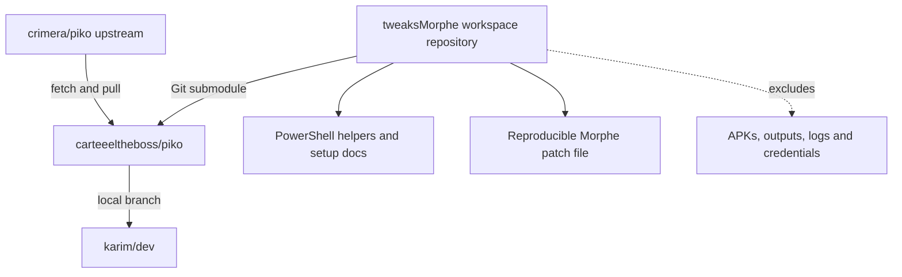

# tweaksMorphe workspace

Windows 11 development workspace for building custom Piko patches and applying them with Morphe.

The actual Piko source is the `piko` Git submodule. It points to:

- Repository: `https://github.com/carteeeltheboss/piko.git`
- Branch: `karim/dev`

This parent repository contains the safe, reproducible parts of the local environment:

- PowerShell build, patch and verification helpers
- Environment and beginner documentation
- The Piko repository as a submodule
- A narrow local Morphe verifier patch

It deliberately excludes original APK/APKM/XAPK files, patched APKs, logs, credentials, SDK/JDK
installations and generated build caches.

## Clone everything

```powershell
git clone --recurse-submodules https://github.com/carteeeltheboss/tweaksMorphe.git
Set-Location .\tweaksMorphe
```

If the repository was cloned without submodules:

```powershell
git submodule update --init --recursive
```

Update Piko to the branch recorded by `.gitmodules`:

```powershell
git submodule update --remote --merge piko
```

## First-time setup

```powershell
.\install-toolchain.ps1
.\verify-env.ps1 -Deep
```

Authenticate GitHub CLI and GitHub Packages if needed:

```powershell
gh auth login
gh auth refresh -h github.com -s read:packages
```

## Recreate Morphe with the local verifier fix

```powershell
git clone -b dev https://github.com/MorpheApp/morphe-desktop morphe-desktop
git -C .\morphe-desktop apply ..\local-patches\morphe-d8-internal-error-warning.patch
.\build-morphe-cli.ps1 -Force
```

If upstream Morphe later contains an equivalent fix, review the upstream code before deciding
whether the local patch is still required.

## Daily workflow

```powershell
.\verify-env.ps1 -Deep
.\build-piko.ps1
.\morphe.ps1 list-versions
.\patch-apks.ps1 -InputDir .\apkFiles\my-test -OutputDir .\output\my-test
```

For the complete beginner journey, repository map, patch anatomy, bytecode concepts, build commands,
APK verification, troubleshooting and Git workflow, read [`piko/HOWTO.md`](piko/HOWTO.md).

## Repository relationship


